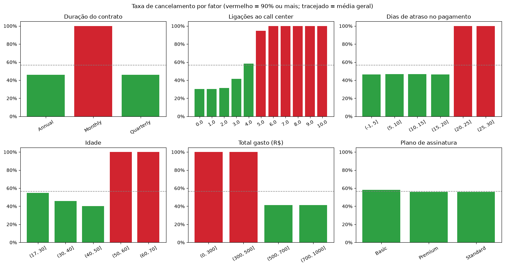

# Análise de Cancelamento de Clientes


Uma empresa com mais de 800 mil clientes descobriu que a maioria já cancelou o
serviço. A análise responde duas perguntas: **o que leva ao cancelamento** e
**quanto ele cai se a empresa agir nos fatores que controla**.



## Principais achados

| Fator | Comportamento |
| --- | --- |
| Contrato mensal | **100%** cancelaram (anual e trimestral: ~46%) |
| Ligações ao call center | até 2: ~30% · 5 ligações: 95% · a partir de 6: **100%** |
| Atraso no pagamento | acima de 20 dias: **100%** |
| Idade | acima de 50 anos: **100%** |
| Plano (Basic, Standard, Premium) | quase não muda a taxa |

## Simulação de impacto

Aplicando apenas os fatores que a empresa controla (contrato, atendimento e
cobrança):

| Cenário | Taxa de cancelamento | Clientes |
| --- | --- | --- |
| Situação atual | 56,7% | 881.659 |
| + sem contrato mensal | 46,1% | 707.454 |
| + até 4 ligações ao call center | 26,4% | 515.048 |
| + até 20 dias de atraso | **18,4%** | 464.479 |

## Recomendações

1. Migrar os clientes do contrato mensal para trimestral ou anual, com
   incentivo.
2. Disparar um alerta na 3ª ligação ao call center, antes de o cliente chegar
   à zona de cancelamento.
3. Fazer cobrança preventiva (lembrete e renegociação) antes dos 20 dias de
   atraso.

> **Ressalva:** limites tão exatos (100%) são típicos de base didática. Numa
> base real eu validaria com um modelo e um teste A/B antes de recomendar.

## Rodando

```bash
git lfs install   # o CSV (62 MB) está no Git LFS
pip install -r requirements.txt
jupyter notebook main.ipynb
```

O notebook usa gráficos estáticos (matplotlib). A versão anterior usava
gráficos interativos que embutiam a base inteira e deixavam o arquivo com
152 MB; agora ele tem cerca de 120 KB.
